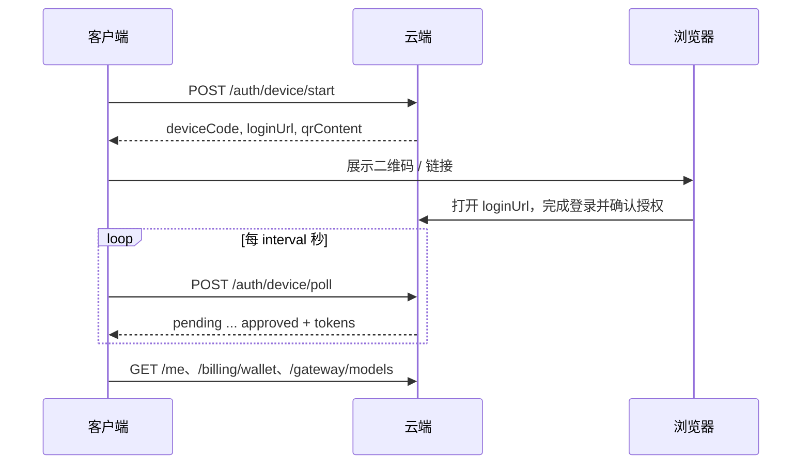
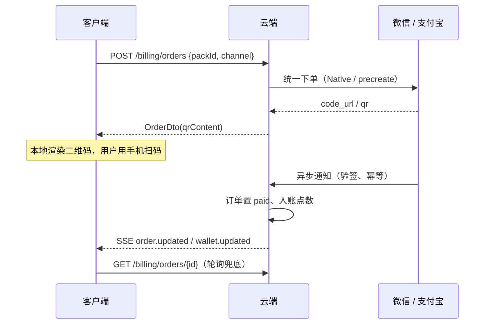
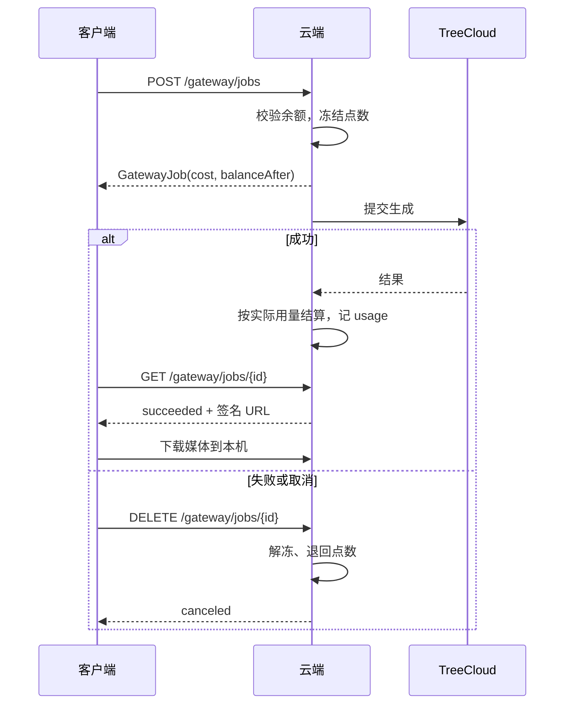

# 云端 API 合同

客户端（桌面 / Web）、开发用 Mock 云（`packages/cloud-mock`）与未来的真实云端共用这一份合同。
类型的权威定义在 [`packages/shared/src/cloud.ts`](../packages/shared/src/cloud.ts)，本文只描述端点、语义与时序；字段有出入时以类型为准。

- **切换方式**：客户端只认一个 base URL（设置 · 云端地址，或环境变量 `AIGC_CLOUD_URL`）。Mock 云换成真实云端不需要改客户端。
- **金额与点数**：金额单位人民币元（两位小数）；点数单位「点」，1 点 = ¥1。
- **字段命名**：JSON 一律 camelCase；时间戳一律毫秒（`expiresAt` 例外，Unix 秒，与 JWT 习惯一致）。

## 通用约定

### 认证

除「元信息」与「设备码登录」端点外，所有请求带 `Authorization: Bearer <accessToken>`。
access token 过期（HTTP 401 / `code: 40101`）时，客户端用 refresh token 调一次 `/auth/refresh`，成功则重放原请求，失败则视为登录失效、回到未登录态。
**refresh token 是一次性的**：每次刷新都签发新的一对，旧的立即作废。

### 错误

所有错误响应用统一结构，`requestId` 用于和日志对账：

```json
{ "code": 40201, "message": "点数不足：需要 1.6 点，当前 0.5 点", "requestId": "req_..." }
```

| code | HTTP | 含义 | 客户端行为 |
| --- | --- | --- | --- |
| 40101 | 401 | token 无效或过期 | 刷新一次；仍失败则登出 |
| 40201 | 402 | 余额不足 | 任务失败，提示去充值 |
| 40301 | 403 | 未登录 / 无权限 | 引导登录 |
| 40401 | 404 | 资源不存在（含他人资源） | 按业务提示 |
| 42901 | 429 | 限流 | 原样展示错误，由用户稍后重试 |
| 50001 | 5xx | 云端内部错误 | 原样展示错误 |
| 50201 | 502 | 上游（TreeCloud）失败 | 任务失败，点数已退回 |

> 客户端目前**不做任何自动重试**（只有 401 后的一次 token 刷新重放），避免重复下单与重复扣费。真实云端如果要返回 `Retry-After`，客户端暂不识别。

## 端点

### 元信息

| 方法 | 路径 | 说明 |
| --- | --- | --- |
| GET | `/meta` | 无需登录。返回 `{ ok, name, version, payChannels, loginMethods }`，客户端用来探测地址是否可用、有哪些支付渠道 |

### 认证（设备码流程）

桌面与 Web 用同一个流程：客户端拿设备码，用户在浏览器（手机或电脑）里确认，客户端轮询拿 token。

| 方法 | 路径 | 请求 | 响应 |
| --- | --- | --- | --- |
| POST | `/auth/device/start` | `{ client: 'desktop' \| 'web', deviceName? }` | `{ deviceCode, loginUrl, qrContent, expiresIn, interval }` |
| POST | `/auth/device/poll` | `{ deviceCode }` | `{ status: 'pending' \| 'approved' \| 'expired' \| 'denied', tokens?, profile? }` |
| POST | `/auth/refresh` | `{ refreshToken }` | `{ tokens, profile? }` |
| POST | `/auth/logout` | `{}` | `{ ok: true }`，使该用户当前 access token 失效 |
| GET | `/me` | — | `UserProfile` |

- `loginUrl` 是云端托管的登录页（手机号 + 验证码 / 微信扫码等由真实云端决定）；客户端只负责展示链接与二维码，**不接触凭证**。
- `expiresIn` 秒内未确认则 `poll` 返回 `expired`。`interval` 是建议轮询间隔（秒）。
- 新用户首次登录由云端创建账号并发放赠送点数。

### 计费

| 方法 | 路径 | 说明 |
| --- | --- | --- |
| GET | `/billing/wallet` | `{ balance, freeToday, updatedAt }`。`freeToday` 为今日剩余免费点数，**先扣免费，再扣余额** |
| GET | `/billing/packs` | 充值档位。促销（如首充翻倍）已按当前用户算好，体现在 `bonusPoints` |
| POST | `/billing/orders` | `{ packId, channel: 'wechat' \| 'alipay' }` → `OrderDto`（含 `qrContent`、`cashierUrl`、`expireAt`） |
| GET | `/billing/orders/{id}` | 查单（客户端轮询用） |
| GET | `/billing/orders` | 当前用户订单历史，按创建时间倒序 |

订单状态：`created`（待支付）→ `paid` / `closed`（超时或取消）→ `refunded`。
点数**只在云端收到支付渠道的异步回调并验签通过后**入账，客户端的任何请求都不能直接加点。`paid` 后会推送 `wallet.updated` 与 `order.updated` 事件。

### 网关

| 方法 | 路径 | 说明 |
| --- | --- | --- |
| GET | `/gateway/models` | 云端模型目录（含单价与计价单位，客户端用来预估） |
| POST | `/gateway/jobs` | 创建生成任务：校验余额 → 冻结点数 → 入队。响应是 `GatewayJob`，含 `cost`、`balanceAfter` |
| GET | `/gateway/jobs/{id}` | 状态、进度、结果（带时效的签名 URL）、失败原因与修复建议 |
| DELETE | `/gateway/jobs/{id}` | 取消：排队中 / 运行中的任务解冻并退回点数；已结束的任务原样返回 |
| POST | `/gateway/chat` | `{ messages, model? }` → `{ text, model?, usage? }`，用于润色与 Agent |

- 参考图用 `dataUrl` 随任务提交（本机文件没有公网地址）。
- 结果媒体 URL 有时效，客户端**拿到后立即下载到本机**。
- 任务失败（含上游失败）时云端自动退回冻结的点数；客户端只展示结果，不做任何加减款。
- `clientJobId` 是客户端任务 ID，用于日志关联。真实云端应当把它作为幂等键（同一 ID 重复提交不重复扣费）；Mock 云未实现，客户端目前也不依赖这一点。

### 用量

| 方法 | 路径 | 说明 |
| --- | --- | --- |
| GET | `/usage/summary` | 近期汇总：请求数、点数、按模型 / 按天拆分 |
| GET | `/usage/requests` | 请求明细，游标分页：`{ items, next? }`。每条带 `requestId`、token / 图片数 / 视频秒数 / 配音字符数 |

### 事件流（SSE）

`GET /events`，登录后长连接，断线由客户端重连。事件：

| 事件 | 载荷 | 触发 |
| --- | --- | --- |
| `wallet.updated` | `{ wallet }` | 余额变化（充值到账、冻结、结算、退回） |
| `order.updated` | `{ order }` | 订单状态变化 |
| `job.updated` | `{ job }` | 任务状态 / 进度变化 |

SSE 只是加速通道：客户端对订单与任务**仍然保留轮询兜底**，事件丢失不影响正确性。

## 时序

### 登录



### 充值



### 生成、取消与退款



## Mock 云与真实云端的差异

Mock 云（`pnpm --filter @aigc/cloud-mock dev`，默认 `:5790`）实现了上面全部端点，用于开发、演示和 CI，**不是安全实现**：

| 项 | Mock 云 | 真实云端 |
| --- | --- | --- |
| 存储 | 内存，重启即清空 | PostgreSQL 等持久化 |
| 登录 | 手机号任意 11 位，无验证码 | 短信 / 微信登录、防刷 |
| 支付 | 收银台页「模拟扫码支付」按钮直接置 paid | 微信支付 v3 / 支付宝，回调验签 |
| 生成 | fixture：极小 PNG / WAV，按估价扣点 | 平台 TreeCloud Key 池，按真实用量结算 |
| 幂等 | 未实现 | `clientJobId` / 订单号幂等 |
| 用量 | 内存数组 | 明细表 + 日汇总 |

契约测试（`packages/server/test/server.test.ts`）对着 Mock 云跑通 登录 → 充值 → 建任务 → 取消退款；真实云端上线后，同一组用例应当照样通过。
